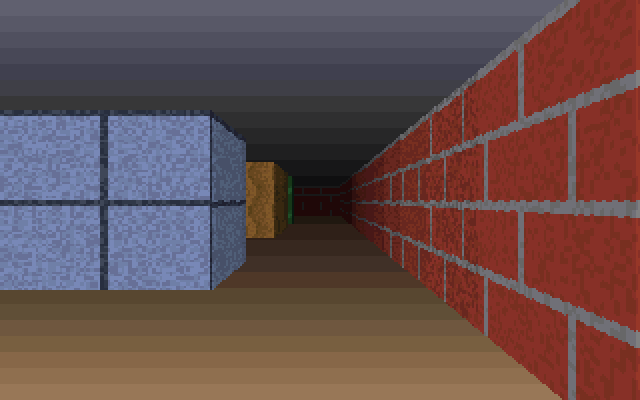
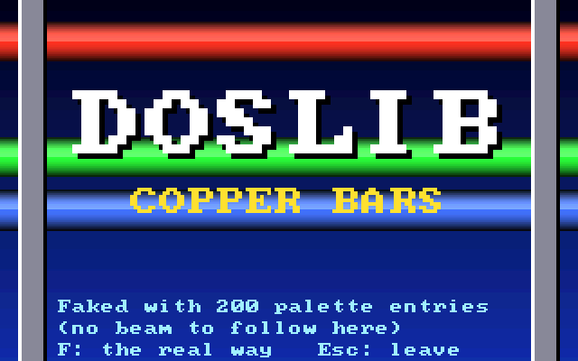
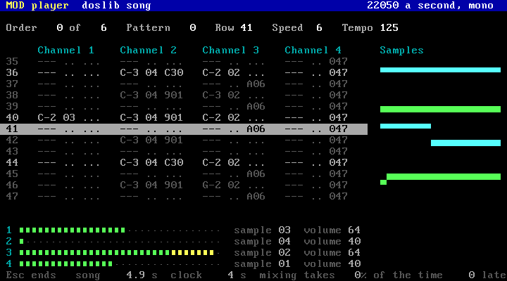
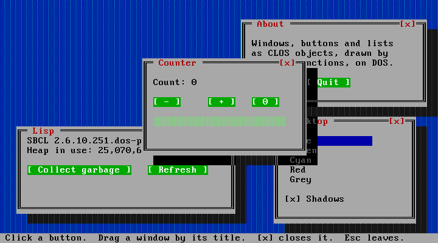

# doslib

Common Lisp on DOS with SBCL: a library for the BIOS, DOS, I/O ports,
memory and video; example programs that use it; and an Emacs-like editor.

It needs the DOS port of SBCL with ASDF and, for the network examples and
nothing else, the `sb-bsd-sockets` contrib and a packet driver. The port is
the `dos-port` branch of <https://github.com/lispnik/sbcl>;
[Building SBCL for DOS](#building-sbcl-for-dos) below says how to make it.

## Systems

`doslib.asd` defines four ASDF systems.

| System | Directory | Package | What it is |
|---|---|---|---|
| `doslib` | `src/` | `doslib` | The library |
| `doslib/examples` | `examples/` | `doslib-examples`, plus one package per example | Example programs |
| `doslib/emacs` | `emacs/` | `doslib-emacs`, `doslib-emacs-user` | The editor |
| `doslib/emacs-extras` | `emacs-extras/` | `doslib-emacs` | More for the editor, built on the examples and the network |

Tell ASDF where the project is (the launcher's `SBCLRC` does this), then
load what you want:

```lisp
(push #p"D:/DOSLIB/" asdf:*central-registry*)
(asdf:load-system :doslib/examples)
```

## The library

```lisp
(asdf:load-system :doslib)
(use-package :doslib)
(video-mode #x13)                 ; BIOS video mode 13h: 320x200, 256 colours
(rainbow-palette)
(dotimes (i 200) (plot i i (1+ (mod i 255))))
(finish)                          ; wait for a key, back to text mode
```

| File | Provides |
|---|---|
| `machine.lisp` | `machine-code`, `int86` (software interrupts), `lo`, `hi`, `word16` |
| `ports.lisp` | `inb`, `outb`, `inw`, `outw`, `inl`, `outl`, `cmos` |
| `dos.lisp` | `real-int`, `real-call` (real-mode interrupts and routines through DPMI), `dos-alloc`, `dos-free`, `dos-scratch`, `dos-string`, `linear`, `without-break-checking` (Ctrl-C as a key), `catching-interrupt` (Ctrl-Break) |
| `cpuid.lisp` | `cpuid` |
| `memory.lisp` | `peek`, `peek16`, `peek32`; `map-physical`, `unmap-physical`, `with-physical-memory`: a device's memory made addressable |
| `interrupts.lisp` | `get-vector`, `set-vector`, `code-selector`, `data-selector` |
| `text.lisp` | `text-put`, `text-box`, `save-text-screen`, `get-key`, `text-input`: text mode by direct video memory |
| `critical.lisp` | `catch-critical-errors`, `critical-error`: DOS device errors without "Abort, Retry, Fail?" |
| `dialog.lisp` | `restart-dialog`, `dialog-ask`: choose a restart from a box on the screen |
| `hotkey.lisp` | `install-hotkey`, `remove-hotkeys`, `poll-hotkeys`: keys taken through the BIOS keyboard intercept |
| `video.lisp` | `video-mode`, `with-video-mode`, `*vga*`, `vesa-set-mode`, `vesa-mode-info`; `display-adapter`, `text-memory-address`, `text-lines`, `text-mode`: which display card, and its text screen |
| | Palettes: `set-palette`, `get-palette`, `rainbow-palette`, `gradient-palette`, `use-palette` (`:grey`, `:fire`, `:ice`, `:ocean`, `:forest`, `:sunset`, `:heat`, `:copper`, `:sepia`, `:amber`, `:phosphor`, `:neon`, `:pastel`, `:earth`), `cube-palette` and `cube-colour`, `save-palette`, `fade-palette`, `rotate-palette` |
| | Drawing in mode 13h, clipped: `plot`, `get-pixel`, `clear-screen`, `draw-line`, `horizontal-line`, `draw-rectangle`, `fill-rectangle`, `draw-circle`, `fill-circle`, `draw-ellipse`, `fill-ellipse`, `draw-polygon`, `fill-polygon`, `fill-area` (flood fill) |
| `gtext.lisp` | `graphics-text`, `draw-glyphs`, `glyph-row`: text in the graphics modes, in the BIOS's 8 by 8 characters |
| `modex.lisp` | `mode-x`, `mode-x-text`, `vga-planes`, `vga-display-start`, `vga-sequencer`, `vga-crtc`, `vga-graphics`, `vga-attribute`: the VGA's registers, and 320x240 in planes |
| `input.lisp` | `ticks`, `wait-tick`, `key-pressed-p`, `wait-key`, `finish`; `timer-count`, `wait-frame`: time finer than the tick |
| `sound.lisp` | `speaker-on`, `speaker-off`, `speaker-beep`: the PC speaker |
| `mouse.lisp` | `mouse-init`, `mouse-position`, `mouse-cell`, `mouse-pixel`, `mouse-show`, `mouse-hide`: the mouse driver |
| `disk.lisp` | `dos-read-sectors`, `bios-read-sectors`: disks, a sector at a time |
| `irq.lisp` | `with-irq-handler`, `install-irq-handler`, `irq-count`, `irq-read-byte`: handlers for hardware interrupts, made to order |
| `keystate.lisp` | `with-key-state`, `key-down-p`, `keys-down`: which keys are held down, from every scan code the keyboard sends |
| `dma.lisp` | `dma-start`, `dma-stop`, `dma-address`, `dma-count`, `with-dma-memory`: the DMA controllers |
| `blaster.lisp` | `blaster-present-p`, `blaster-write`, `blaster-read`, `blaster-version`, `with-blaster-interrupt`, `blaster-interrupts`: the Sound Blaster's settings, its processor and its interrupt |
| `pci.lisp` | `pci-read`, `pci-write`, `pci-devices`: PCI configuration space |
| `serial.lisp` | `serial-open`, `serial-read-byte`, `serial-write-string`: serial ports, polled |
| `clipboard.lisp` | `clipboard-present-p`, `clipboard-text` (and its `setf`): the clipboard an emulator or Windows shares with DOS programs |
| `init.lisp` | `doslib-init`, run at load and whenever a saved core starts |

`doc/reference.md` lists every exported name with its arguments and what
it does; `sbcl --script doc/make-reference.lisp` makes it again from the
documentation strings in the sources.

The instructions Lisp cannot express (INT, IN, OUT, CPUID) are assembled
by hand into malloc'ed memory and called with `alien-funcall`.

### Interrupting a program

Ctrl-Break stops Lisp that is running, even a loop that calls nothing:
the condition `sb-sys:interactive-interrupt` is signalled there, and if
nothing handles it SBCL's debugger opens, with a restart that carries on.
Ctrl, Alt and Shift pressed together do the same, for keyboards that have
no Break key (`(setf (interrupt-chord) nil)` turns that off); so does
Ctrl-C, once DOS notices it, which is when the program next calls DOS.

```lisp
(catching-interrupt (loop))       ; => :INTERRUPTED, when you have had enough
```

`doslib-examples:run` catches the interrupt and puts the screen back in
text mode.  In the editor, Ctrl-Break during an evaluation opens the
editor's debugger on it, and at any other time stops the command that is
running.  This needs the DOS port's runtime of November 2026 or later
(`(interrupts-supported-p)` says whether it is there).

## The examples

**[Pictures of the examples](screenshots/README.md)** — the display of
the DOS machine while each one runs.

[](screenshots/README.md)
[](screenshots/README.md)
[](screenshots/README.md)
[](screenshots/README.md)
[](screenshots/README.md)
[](screenshots/README.md)

```lisp
(asdf:load-system :doslib/examples)
(doslib-examples:list-examples)             ; what there is
(doslib-examples:menu)                      ; choose from a list
(doslib-examples:run "fire")                ; run one
(doslib-examples:run "wget" "http://example.com/")
(doslib-examples:build-executable "life" "life.exe")   ; a stand-alone program
```

Each example is one file with a package of its own,
`doslib-examples.<name>`, that exports `main`.

| Category | Examples |
|---|---|
| `graphics/` | blit bmpview compiled copper dirty fire flip font formula gcviz latch lfb lsystem mandel mode12 modex paint palette palettes parallax picview plasma raycast raytrace rotozoom scroll shapes solid3d split sprite stars textfont textfx tiles tunnel turtle vesa wire3d |
| `system/` | alarm asm asmdsl calc cdrom diskinfo driver dosinfo fatview floppy intvec ivt joystick keys mcbwalk memmap pciscan ports printer probes serial speed step sysinfo term timer vop xms |
| `lisp/` | bench faults hotfix life live restarts resume shell snake special windows |
| `sound/` | adlib blaster dmascope midi mixer modplay record speaker spectrum tune |
| `network/` | browse files irc netpong ntp remote websrv wget |

`data/` holds files the examples read; `support/` holds the host-side
half of the serial example.

Some show one hardware technique each:

| Technique | Examples |
|---|---|
| Blitting | `blit` (a back buffer), `dirty` (dirty rectangles), `compiled` (sprites as machine code) |
| Mode X | `flip` (page flipping), `scroll` (hardware scrolling), `latch` (copies inside video memory) |
| Other video | `lfb` (the VESA linear framebuffer), `copper` (a palette entry changed on every scanline) |
| Scrolling worlds | `tiles` (a tile map, only the new column drawn), `parallax` (three layers and sprites, redrawn and flipped), `split` (a status bar by the line-compare register) |
| Palette and fonts | `palette` (cycling, fades and cross-fades with no pixel redrawn), `palettes` (the library's palettes by name, on one picture), `shapes` (the drawing functions: rectangles, ellipses, polygons, a fill), `textfont` (glyphs redefined in plane 2, 80 by 50) |
| Planar 16 colours | `mode12` (640x480 through the graphics controller: bit mask, set/reset, write modes, latches, XOR) |
| Demo-scene effects | `rotozoom`, `tunnel`, `solid3d` (filled, shaded and texture-mapped polygons) |
| Picture files | `bmpview`, `picview` (PCX and GIF decoders in Lisp) |
| Sound engines | `mixer` (eight voices mixed in Lisp), `modplay` (ProTracker modules, from a file too), `tune` (AdLib music from the timer interrupt), `midi` (an MPU-401), `spectrum` (an FFT of what is playing) |
| DMA | `blaster` (playing), `dmascope` (the controller's registers, live), `record`, `modplay` (a MOD player), `floppy` (a sector without the BIOS) |
| Interrupts and timing | `timer` (the timer chip at 1000 Hz), `alarm` (the real-time clock's interrupt), `keys` (which keys are held down), `term` (a serial terminal, received by interrupt), `step` (single-stepping machine code) |
| Other hardware and drivers | `joystick` (the game port's timers), `xms` (extended and expanded memory), `cdrom` (MSCDEX, raw sectors, audio tracks), `speed` (the time-stamp counter, and ways to copy memory) |

`blaster`, `dmascope`, `record` and `modplay` want a Sound Blaster (the launcher's QEMU machine has an
`sb16`); `sprite`, `paint` and `windows` want a mouse driver.

To add one, write a file with a `main` function, register it with
`doslib-examples:define-example`, and list it in `doslib.asd`.

## The editor

```lisp
(asdf:load-system :doslib/emacs)
(doslib-emacs:emacs)              ; or (doslib-emacs:emacs "file"), or (ed "file")
(doslib-emacs:build-emacs)        ; save it as EMACS.EXE
```

`F1` lists the keys. `C-c C-z` opens the REPL, `C-x d` is Dired, and
`C-x C-c` leaves. An error in evaluated code opens a debugger that lists
the restarts; so does Ctrl-Break, if the code will not stop. `M-.` goes to
the definition of the name at the cursor and `M-,` comes back; `C-_`
undoes and `M-_` redoes.

Dired (`C-x d`) colours its lines after GNU Emacs: directories blue,
programs green, Lisp source white, files flagged for deletion red, and
backups and compiled files (`.fasl`, `.fas`, `.bak`, `file~` and the like)
dimmed. `M-x dired-toggle-colours` turns that off and on; in `EMACSRC.LSP`,
`(setf doslib-emacs:*dired-colours* nil)` starts without it, and
`*dired-ignored-extensions*` and `*dired-faces*` say what is dimmed and
which colours are used. `v` views the file on the line: read-only, with
`SPC` and Backspace to page, `q` to come back to the listing and `e` to
edit after all (`M-x view-file` does the same for any file, and `C-x C-q`
makes any buffer read-only or not). The mode line shows `%%` for a buffer
that may not be changed.

**Modes**, as in GNU Emacs. A buffer has one major mode and any number
of minor modes, and both are made by definitions that can go in
`EMACSRC.LSP`:

```lisp
;; A major mode derived from another has its parent's keys where it binds
;; none itself, is coloured and indented as its parent is, and runs its
;; parent's hooks before its own.  M-x scheme-mode, and .scm files.
(define-major-mode scheme-mode lisp-mode
    (:lighter "Scheme" :extensions ("scm") :keys (("C-c C-s" save-buffer)))
  "For Scheme source."
  (setf fill-column 72))                       ; run when a buffer enters the mode

;; A hook: functions called when a buffer enters a mode.
(add-hook 'lisp-mode-hook 'my-lisp-setup)
(add-hook 'dired-mode-hook 'dired-omit-mode)   ; a minor mode's command turns it on

;; A buffer-local variable: read and SETF like any variable, and it means
;; its value in the current buffer.  A change of major mode forgets it.
(defvar-local fill-column 70 "Where lines are broken.")
(setf (default-value 'fill-column) 76)

;; A minor mode: a command, a variable that is true where it is on, a hook
;; (shout-mode-hook), keys looked up before the major mode's, and a word
;; in the mode line.  :global t makes it one mode for every buffer.
(define-minor-mode shout-mode (:lighter "Shout" :keys (("<f9>" upcase-word)))
  "Capitals at a key."
  (when on (message "Shouting in ~A" (buf-name buffer))))
```

Keys are looked up in the minor modes that are on, then the major mode
and the modes it is derived from, then the keys that work everywhere.
Changing a buffer's major mode is a fresh start, as in Emacs: its minor
modes go off and its own values are forgotten (`:permanent t` keeps one).
`C-h m` describes a buffer's modes, what they are derived from, their
hooks and the buffer's own values. View mode is a minor mode; so is
Dired's Omit mode: `M-o` in Dired hides the backups and compiled files
that are otherwise dimmed, and shows them again (the heading says how
many are omitted). `M-x global-dired-omit-mode` is a globalized one: Omit
mode in every Dired buffer, those opened later too.

The editor documents itself, behind `C-h` as in GNU Emacs: `C-h k` says
what a key does (`C-h c` in one line), `C-h w` where a command is on the
keyboard, `C-h a` lists the commands with some words in their names and
`C-h d` those whose documentation mentions them, `C-h f`, `C-h x` and
`C-h v` describe a function, a command and a variable, `C-h m` the mode of
the buffer and its keys, `C-h l` shows the last keys typed and `C-h e` the
messages there have been. `C-h ?` lists them all. (For any Lisp symbol,
not only the editor's: `C-h o` describes and `C-c C-d a` is apropos.)

`F11` switches the screen between 25 lines and 50, in place: on a VGA the
number of lines is a matter of the font, so nothing is redrawn but the
editor's own windows. `M-x set-screen-size` offers 80x28 as well, and
whatever larger text modes (132 columns, 60 lines) the card's VESA BIOS
has. `(doslib-emacs:screen-size 80 50)` in `EMACSRC.LSP` starts the editor
that way. A program run from the editor gets the usual 25 lines, and the
editor takes its own size back afterwards.

The editor asks which display card there is (`(doslib:display-adapter)`)
and goes by the answer: an EGA has 25 lines and 43, a CGA or a monochrome
card 25; on a monochrome card (MDA, Hercules) the text is at B0000h and
the colours become normal, bright and reversed.

Where the machine shares a clipboard with DOS programs, killed text
(`C-w`, `M-w`, `C-k`) goes to it and `C-y` yanks what another program put
there: in DOSBox-X that is the Mac's clipboard (`./run-dos.sh dosbox`
turns it on). From Lisp it is `(doslib:clipboard-text)`, which can be
`setf`; `(doslib:clipboard-present-p)` is false on plain DOS.

### Editing Lisp

The editor runs in the same Lisp as the code it edits, and treats that
code as expressions. `C-M-` is Ctrl and Alt together; `ESC` and then the
Ctrl key does the same, for a host that keeps Ctrl-Alt to itself.

| Keys | What they do |
|---|---|
| `C-M-f`, `C-M-b` | Forward and back over an expression |
| `C-M-u`, `C-M-d`, `M-)` | Out of this list to its start, into the next list, out past its end |
| `C-M-a`, `C-M-e` | To the start and the end of the top-level form |
| `C-M-k`, `C-M-<backspace>` | Kill the expression after point, or before it |
| `C-M-SPC`, `C-M-h` | Mark the expression; mark the top-level form |
| `C-M-t` | Swap the expressions either side of point |
| `TAB`, `C-M-q`, `M-q`, `C-M-\` | Indent the line, the expression after point, the top-level form, the region |
| `M-;` | Comment the region out, or take its comments off; without a region, a comment on this line |
| `M-(` | A pair of parentheses, round the region if there is one |
| `M-s`, `M-r` | Take this list's parentheses away; put the expression after point in place of its list |
| `C-c )`, `C-c }` | Move the closing parenthesis out past the next expression, or back in before the last |
| `M-TAB`, `M-/` (and `TAB` in the REPL) | Complete the symbol before point from the running Lisp |
| `SPC` | After a function's or macro's name, its arguments appear in the echo area |
| `C-c C-d d`, `C-c C-d a` | Describe a symbol; list the symbols with some text in their names |
| `C-c RET`, `C-c M-m` | Expand the macro call at point once, or all the way down |
| `C-x C-e`, `C-c C-c`, `C-c C-r`, `C-c C-b` | Evaluate the expression before point, the top-level form, the region, the buffer |
| `C-u C-x C-e` | Evaluate the expression before point and insert the result |
| `C-c C-k` | Save, compile and load the file; what the compiler said is in `*compilation*` |
| `C-M-x` (and `C-c C-c`) | Evaluate the top-level form; a `defvar` gives its variable the value again |
| `C-c I` | The inspector: evaluate an expression and look at the value part by part (`RET` into a part, `l` back, `d` describe, `q` leave) |
| `C-c i` | Go to one of this buffer's definitions by name, with completion |
| `C-c C-t`, `C-c M-d`, `C-c C-u` | Trace or untrace a function; disassemble one; undefine one |
| `C-c M-p`, `C-c M-o` | Put the REPL in this buffer's package; empty the REPL |
| `M-r` in the REPL | Recall the most recent input containing some text |
| `M-x check-parens` | Go to a parenthesis that has no partner |
| `M-x electric-pair-mode` | `(` and `"` bring their partners; Backspace takes an empty pair |

Strings and `#| |#` comments are coloured across the lines they run over.

Code in a file is read in the package of the nearest `(in-package ...)`
above it; `*scratch*` and the REPL share the REPL's package.

### The extras

`(asdf:load-system :doslib/emacs-extras)` adds these; the `EMACS.EXE` that
the launcher builds has them.

| Command | What it does |
|---|---|
| `M-x run-example` (`C-c x`) | Run an example, with completion on its name, and come back |
| `M-x quickload` (`C-c q`) | Load a system with Quicklisp, with completion; output in `*quickload*` |
| `F12` | The pop-up calculator (`M-x calculator-hotkey` turns it off) |
| `M-x restart-dialog-mode` | Errors in evaluated code offer their restarts in a box |
| `M-x hex-find-file`, `M-x hex-disk-sector` | A hex editor for files; disk sectors, read-only |
| `M-x browse-url` | A text browser for plain HTTP and Gopher: `TAB` to a link, `RET` follows, `b` back |
| `M-x irc` | An IRC client: a buffer per channel, filled while the editor is idle |
| The mouse | Click to put the cursor somewhere, drag to select, turn the wheel to move; `M-x mouse-mode` turns it off |
| `M-x blocks`, `M-x snake` | Games, in a buffer |
| `M-x live` | Live coding on two displays: the editor moves to the second, and the VGA shows what the code draws, redefined as you type (`M-x live-stop` ends it) |

`M-x live` needs a second display card: QEMU's and UTM's `secondary-vga`
(the launcher's machines have one), or a monochrome card beside the VGA.

A mode of your own can do what these do: an idle hook (`add-idle-hook`)
is called while the editor waits for a key, and properties on the mode's
name colour its lines and hear of its buffers being killed (see
`mode-hook` in `emacs/buffers.lisp`).

What you type at the REPL is read in the package `doslib-emacs-user`
(nickname `emacs-user`), which uses Lisp, `doslib` and everything the
editor exports. Extend the editor from there, or from `EMACSRC.LSP` in the
current directory:

```lisp
(define-command insert-date ()
  "Insert today's date."
  (multiple-value-bind (s m h day month year) (get-decoded-time)
    (declare (ignore s m h))
    (insert (format nil "~D-~2,'0D-~2,'0D" year month day))))
(bind-key "C-c d" 'insert-date)
```

## Building SBCL for DOS

The port is a branch of SBCL, not part of this project:
<https://github.com/lispnik/sbcl>, branch `dos-port`. It makes a 32-bit
protected-mode `SBCL.EXE` that runs on FreeDOS under the HX extender's DPMI
host (`HDPMI32.EXE`), with the long-file-name driver DOSLFN loaded, on a
Pentium Pro or later with a floating-point unit.

DOS cannot host the build. The C runtime is cross-compiled on a Unix
machine with Open Watcom, and the steps that must run the new Lisp (the
warm load and saving the core) run on FreeDOS in QEMU. It has been built on
macOS on Apple silicon; the makefile also names the Open Watcom binaries
for Intel macOS and for Linux, which have not been tried.

On the build machine, from a package manager: a host SBCL (as any SBCL
build needs), GNU make, `qemu-system-i386`, `mtools`, `nasm`, `objconv`
and an `i386-elf-gcc` cross-compiler (used only to assemble one file).

Then a directory of downloads, `sbcl-dos-tools`, beside the SBCL tree
(or anywhere, named by `SBCL_DOS_TOOLS`):

| In `sbcl-dos-tools/` | What | From |
|---|---|---|
| `ow/` | An Open Watcom v2 snapshot (`ow-snapshot.tar.xz`), unpacked | <https://github.com/open-watcom/open-watcom-v2> |
| `dl-hx/rt/`, `dl-hx/dev/` | The HX runtime and development kits (`HXRT`, `HXDEV`), unpacked | <https://github.com/Baron-von-Riedesel/HX> |
| `dl-freedos/lite/FD14LITE.img` | The FreeDOS 1.4 "LiteUSB" image | <https://www.freedos.org> |
| `dl-watt32/src/` | Watt-32, the TCP/IP library (for sockets) | <https://github.com/gvanem/Watt-32> |
| `dl-pktdrv/crynwr/` | The Crynwr packet drivers (for sockets, when running) | the Crynwr collection |
| `dl-quicklisp/quicklisp.lisp` | Optional | <https://beta.quicklisp.org/quicklisp.lisp> |

```sh
git clone -b dos-port https://github.com/lispnik/sbcl sbcl-dos-experiment
cd sbcl-dos-experiment
sh tools-for-build/dos-watt32.sh          # the TCP/IP library; skip it to build without sockets
./make-dos.sh                             # the runtime, then the core: src/runtime/sbcl.exe, output/sbcl.core
./make-dos-contrib.sh asdf sb-bsd-sockets sb-posix
```

`make-dos.sh` takes a while: the warm build runs in the emulator. The
scripts' own comments say more (`make-dos.sh`, `make-dos-contrib.sh`,
`src/runtime/Makefile.dos`, `tools-for-build/dos-run.sh`). The names here
are the ones the scripts default to: this project's launcher looks for the
SBCL tree in `sbcl-dos-experiment` next to `sbcl-dos-tools` unless
`SBCL_SRC` says otherwise, and for this project inside `sbcl-dos-tools`.

To run the result without this project, put `sbcl.exe`, `hdpmi32.exe` and
`sbcl.core` in one directory on a FreeDOS disk, with the contribs in a
`CONTRIB` directory beside them, load DOSLFN, and type `sbcl`.

## Running it

`./run-dos.sh` starts FreeDOS in QEMU with SBCL, ASDF and this project
installed in `D:\DOSLIB`; `./run-dos.sh utm` does the same for UTM, and
`./run-dos.sh build` compiles everything on the DOS machine. At the DOS
prompt, `demo` lists the examples, `demo plasma` runs one (`demo speaker
scale` passes it an argument), and `emacs` starts the editor. The comments at the top of the script say what it
needs: QEMU, mtools, a FreeDOS image, a packet driver, and SBCL built for
DOS.

`./run-dos.sh dosbox` runs the same build in DOSBox-X, which is its own
DOS: drive `D:` is a Mac folder filled from the QEMU machine's disk, and
`P:` is this project's folder itself (or `./run-dos.sh dosbox FOLDER`), so
a file edited on the Mac is loaded with `(load "P:/examples/graphics/fire.lisp")`
and nothing is copied. The Mac's clipboard is shared, there is no network,
and `RUN_DOS_DOSBOX_MACHINE=ega` (or `cga`, `hercules`, `mda`, `vgaonly`,
`svga_et4000`) chooses the display card.

## Tests

`tests/run.py` runs the regression tests, on DOS: it boots a copy of the
launcher's disks in QEMU without a window, types at the machine and reads
its screen.

```
./run-dos.sh update && ./run-dos.sh build     # the tests run what was last built
tests/run.py                                  # everything: about twelve minutes
tests/run.py unit fire emacs-edit             # some of it
tests/run.py --list
```

| Kind | What it does |
|---|---|
| `unit` | `tests/unit.lisp`, loaded into Lisp on the DOS machine: the library, function by function |
| `example` | Starts each example, checks what it shows (text, or the video mode and that something was drawn), operates it where that is cheap, and leaves it; the network examples talk to servers the runner starts on this computer |
| `dos` | Programs typed at the DOS prompt: `DEMO`, a saved program, and `EMACS.EXE` driven through its keys, with the files it saved compared afterwards |

The tests are listed in `tests/cases.py`; `tests/run.py --look NAME` runs
an example and prints what it puts on the screen, which is how to start
a test for a new one.  The screen of a test that fails is kept in the
launcher's `vm/test` directory.  It needs QEMU, mtools and Python 3.

`tests/dosbox.py` is for the display cards QEMU does not have: it starts
the editor in DOSBox-X as a VGA with a VESA BIOS, a plain VGA, an EGA, a
CGA, a Hercules card and an MDA, and checks that the card is named
rightly, that the sizes offered are the card's, that the mode line is
where it should be in each, and the clipboard. Under a minute, no window.

`tests/shots.py` takes the pictures in [screenshots/](screenshots/README.md):
it runs each example as its test does and saves the display.

## Quicklisp

Quicklisp works on the DOS port, given the `sb-posix` subset that
`make-dos-contrib.sh sb-posix` builds in the SBCL tree. With
`quicklisp.lisp` on the DOS disk (the launcher copies it from
`dl-quicklisp/` if it is there), `ql` at the DOS prompt installs Quicklisp
the first time and starts SBCL with it loaded after that:

```lisp
(ql:quickload "cl-ppcre")
(cl-ppcre:regex-replace-all "(\\w+) on (\\w+)" "Lisp on DOS" "\\2 runs \\1")   ; => "DOS runs Lisp"
```

Libraries are fetched over plain HTTP, so there is no TLS involved; ones
that need foreign libraries or threads will not load.

Screenshots are in `doc/shots/`.
